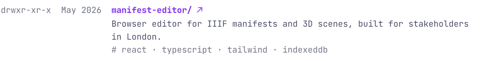
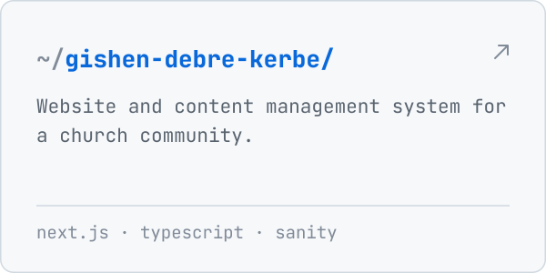

<picture>
  <source media="(prefers-color-scheme: dark)" srcset="assets/hero-dark.svg">
  
</picture>

Hi, I'm Simon. I write code for two people: whoever uses the app, and the teammate who opens the file after me. I finished my B.S. in Computer Science at UW–Stout in May 2026 with a 3.89 GPA, and I'm looking for a full-time software engineering role.

## Right now

I'm a software development intern at **ShyftFi**, connecting Odoo ERP to AWS with Python. So far I've moved financial records to archiving instead of deletion, added a field-by-field audit trail to orders and invoices, and rebranded the customer portal. Next up is a regression suite for the v20 platform upgrade.

Most of that work lives in private repos, so this profile looks quieter than my week does.

## Things I've built

  <a href="https://wilsont0554.github.io/ManifestEditor/"><picture><source media="(prefers-color-scheme: dark)" srcset="assets/manifest-editor-dark.svg"></picture></a>
  <a href="https://michaelt919.github.io/Kintsugi3DBuilder/"><picture><source media="(prefers-color-scheme: dark)" srcset="assets/kintsugi-dark.svg"></picture></a>
  <a href="https://www.gishendebrekerbe.com"><picture><source media="(prefers-color-scheme: dark)" srcset="assets/church-site-dark.svg"></picture></a>
  <a href="https://github.com/CSTP2305-BlueMango/UniMentor"><picture><source media="(prefers-color-scheme: dark)" srcset="assets/unimentor-dark.svg"></picture></a>

## Practice

I solve LeetCode problems to keep my fundamentals sharp. Here's the last year:

<a href="https://leetcode.com/u/000433430/">
  <picture>
    <source media="(prefers-color-scheme: dark)" srcset="https://leetcard.jacoblin.cool/000433430?theme=dark&font=Nunito&ext=heatmap&radius=28&border=0">
    
  </picture>
</a>

## What I work with

<picture>
  <source media="(prefers-color-scheme: dark)" srcset="https://skillicons.dev/icons?i=ts,js,py,java,react,nextjs,tailwind,swift,mysql,mongodb,firebase,aws,git,github,figma&theme=dark&perline=8">
  
</picture>

## Off the keyboard

I was president of UW–Stout's Habitat for Humanity chapter, I volunteered at the Dunn County Humane Society, and I speak English and Vietnamese.

## Say hi

&nbsp;

