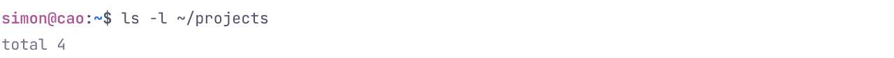
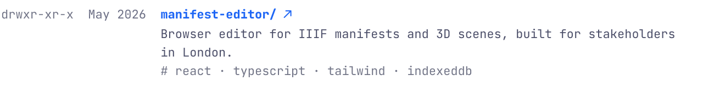
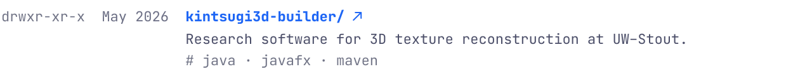
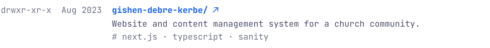
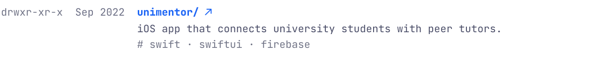

<picture>
  <source media="(prefers-color-scheme: dark)" srcset="assets/dark/hero.svg">
  
</picture>

Software engineer building full-stack web apps with React, TypeScript and Python. I graduated from the University of Wisconsin–Stout in 2026 with a B.S. in Computer Science, and I'm currently a software development intern at ShyftFi LLC.

`mail` [caosonminh2000@gmail.com](mailto:caosonminh2000@gmail.com) &nbsp;·&nbsp; `linkedin` [simon-cao](https://www.linkedin.com/in/simon-cao-135122197/)

## Projects

<picture><source media="(prefers-color-scheme: dark)" srcset="assets/dark/projects.svg"></picture>
<a href="https://wilsont0554.github.io/ManifestEditor/"><picture><source media="(prefers-color-scheme: dark)" srcset="assets/dark/manifest-editor.svg"></picture></a>
<a href="https://kaelie-tetzlaff.github.io/Kintsugi3DBuilder/"><picture><source media="(prefers-color-scheme: dark)" srcset="assets/dark/kintsugi.svg"></picture></a>
<a href="https://www.gishendebrekerbe.com"><picture><source media="(prefers-color-scheme: dark)" srcset="assets/dark/church-site.svg"></picture></a>
<a href="https://github.com/CSTP2305-BlueMango/UniMentor"><picture><source media="(prefers-color-scheme: dark)" srcset="assets/dark/unimentor.svg"></picture></a>

## Stack

<picture>
  <source media="(prefers-color-scheme: dark)" srcset="assets/dark/stack.svg">
  
</picture>

## LeetCode

<a href="https://leetcode.com/u/000433430/">
  <picture>
    <source media="(prefers-color-scheme: dark)" srcset="assets/dark/leetcode.svg">
    
  </picture>
</a>
