<picture>
  <source media="(prefers-color-scheme: dark)" srcset="assets/hero-dark.svg">
  
</picture>

Software engineer building full-stack web apps with React, TypeScript and Python. I graduated from the University of Wisconsin–Stout in 2026 with a B.S. in Computer Science, and I'm currently a software development intern at ShyftFi.

## Projects

  <a href="https://wilsont0554.github.io/ManifestEditor/"><picture><source media="(prefers-color-scheme: dark)" srcset="assets/manifest-editor-dark.svg"></picture></a>
  <a href="https://michaelt919.github.io/Kintsugi3DBuilder/"><picture><source media="(prefers-color-scheme: dark)" srcset="assets/kintsugi-dark.svg"></picture></a>
  <a href="https://www.gishendebrekerbe.com"><picture><source media="(prefers-color-scheme: dark)" srcset="assets/church-site-dark.svg"></picture></a>
  <a href="https://github.com/CSTP2305-BlueMango/UniMentor"><picture><source media="(prefers-color-scheme: dark)" srcset="assets/unimentor-dark.svg"></picture></a>

## LeetCode

<a href="https://leetcode.com/u/000433430/">
  <picture>
    <source media="(prefers-color-scheme: dark)" srcset="assets/leetcode-dark.svg">
    
  </picture>
</a>

## Tools

<picture>
  <source media="(prefers-color-scheme: dark)" srcset="https://skillicons.dev/icons?i=ts,js,py,java,react,nextjs,tailwind,swift,mysql,mongodb,firebase,aws,git,github,figma&theme=dark&perline=8">
  
</picture>

## Contact

<a href="mailto:caosonminh2000@gmail.com"><picture><source media="(prefers-color-scheme: dark)" srcset="assets/email-dark.svg"></picture></a>&nbsp;
<a href="https://www.linkedin.com/in/simon-cao-135122197/"><picture><source media="(prefers-color-scheme: dark)" srcset="assets/linkedin-dark.svg"></picture></a>
